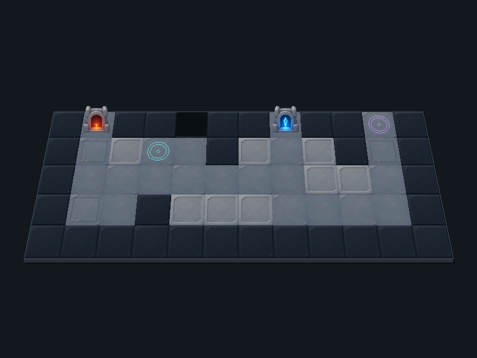

# 던전 원정대

게임공학과 **2023184009 김연준**의 2D 게임 프로그래밍 프로젝트입니다.

던전을 탐험하며 동료를 모집하고 강화해 최종 보스를 쓰러뜨리는 **타워 디펜스 형식의 로그라이크 게임**을 기획합니다. Python과 pico2d로 개발할 예정입니다.

## 제출 자료

- **발표 동영상:** [YouTube에서 보기](https://www.youtube.com/watch?v=OwTFQGSFT5A)
- **발표 PPT:** [6장 발표 자료 다운로드](docs/발표_PPT_던전원정대_김연준.pptx)
- **기획서 PPT:** [스프라이트를 포함한 24장 상세 기획서 다운로드](docs/기획서_PPT_던전원정대_김연준.pptx)
- [텍스트 기획서](docs/기획서.md)
- [발표 대본](docs/발표대본.txt)

## 게임 소개

처음에는 동료 3명으로 탐험을 시작합니다. 근접·원거리·힐러·특수 직업군을 조합해 최대 6명으로 파티를 편성하고, 배치 비용을 사용해 던전의 칸에 배치합니다. 기본 공격과 회복은 자동으로, 스킬은 플레이어가 직접 사용합니다.

일반 스테이지를 클리어하면 **동료 모집 / 기존 동료 강화 / 유물 획득 중 하나**를 선택합니다. 강화를 통해 새로운 스킬을 해금하고, 파티와 유물의 조합을 발전시켜 던전 최심부의 보스에 도전합니다.

## 목표 범위

| 항목 | 초기 개발 목표 |
| --- | --- |
| 동료 | 4개 직업군, 8명 / 전투 편성 최대 6명 |
| 스킬 | 동료당 2개, 총 16종 / 강화로 두 번째 스킬 해금 |
| 성장 | 동료 모집, 동료·스킬 강화, 유물 6종 |
| 전투 | 일반 스테이지 4개와 최종 보스전 1개 |
| 몬스터와 맵 | 일반 몬스터 2종, 보스 1종, 전투 맵 3종 |

전투 방에는 맵과 함께 남은 적 수, 수비 포인트, 배치 코스트, 캐릭터 카드가 표시됩니다.

## 실행 방법

VS Code에서 pico2d가 설치된 Python 환경을 선택하고 `game/code/main.py`를 실행합니다. 타이틀에서 아무 키나 누르거나 클릭하면 약도가 열립니다. 시작 방을 클릭해 인접 방을 열고 전투 방을 선택합니다. 전투 화면에서 **Q**를 누르면 방을 클리어 처리하고 약도로 돌아갑니다. **Esc**는 전투 화면에서 약도로 돌아가고, 타이틀이나 약도에서는 게임을 종료합니다.

전투에서는 코스트가 충분한 캐릭터 카드를 칸으로 끌어 놓으면 방향 선택 화살표가 나타납니다. 화살표 또는 중앙을 누른 채 원하는 방향으로 당겼다가 놓으면 배치가 확정되고 코스트가 한 번 차감됩니다. 방향을 선택하는 동안 캐릭터 모습이 바뀌며 시간은 기존의 절반 속도로 흐릅니다. **우클릭·Esc**는 배치를 취소하며, 방향 선택 중 중앙에서 놓으면 확정하지 않고 다시 선택할 수 있습니다.

카드를 끌어 배치할 칸을 고르는 동안에는 사거리를 숨깁니다. 칸에 놓고 방향을 선택할 때 주황색 반투명 사거리가 표시되며, 방향 화살표를 돌리면 함께 회전합니다. 배치를 확정하면 선택과 사거리 표시를 해제하고 설정된 전투 속도로 돌아옵니다. 배치 후에는 캐릭터 몸이나 서 있는 칸을 다시 클릭해 사거리를 확인할 수 있습니다. 선택한 캐릭터의 사거리를 보는 동안에도 전투 시간은 기존의 절반 속도로 흐릅니다. 빈 곳 클릭·우클릭·Esc로 표시를 닫으면 설정된 전투 속도로 돌아옵니다. 표시를 닫은 뒤 Esc를 누르면 약도로 돌아갑니다.

몬스터는 전투 시간 기준 1초 간격으로 출현하며, 맵에서 받은 출발점과 가장 가까운 도달 가능 거점을 잇는 고정 경로로 이동합니다. 기본 이동 속도는 전투 시간 1초당 0.6칸이며 몬스터별 `moveSpeed`로 조절할 수 있습니다. 거점 도착 시 화면에서 사라지고 남은 적 수가 줄어듭니다. 현재는 이동·저지와 공격 모션까지 연결되어 있으며, 피해·자동 승패 처리는 아직 구현하지 않았습니다.

배치한 캐릭터는 바라보는 방향의 공격 범위에 살아 있는 몬스터가 들어오면 자동으로 공격 모션을 반복하고, 범위에 몬스터가 없으면 대기 모션으로 돌아갑니다. 이동 중인 몬스터의 현재 칸으로 판정하며 캐릭터 선택 여부와 관계없이 동작합니다. `attackSpeed`는 전투 시간 1초당 공격 횟수로, `0.5`는 2초에 한 번, `1`은 1초에 한 번, `2`는 1초에 두 번입니다. 배치·사거리 확인 중 시간 감속도 공격 모션에 함께 적용됩니다.

지상에 배치한 캐릭터는 자신의 `canStop` 수만큼 접촉한 몬스터를 저지합니다. `0`이면 모두 통과하고, `1`이면 한 마리, `2`이면 두 마리를 붙잡으며 초과한 적은 지나갑니다. 이미 붙잡은 적은 계속 유지하고, 저지된 몬스터는 제자리에서 공격 모션을 재생합니다. 고지대에서는 지상의 적을 저지하지 않습니다. 캐릭터가 사라지거나 죽으면 적이 원래 경로로 다시 이동하며, 적이 사라지면 저지 자리를 다시 사용할 수 있습니다.

몬스터마다 생성 시 걷기 시작 프레임을 무작위로 정해 동작이 똑같이 맞춰지는 것을 줄입니다. 이후에는 선택된 프레임부터 정상 순서로 반복하며 전투 배속을 따릅니다.

```powershell
python -m pip install -r requirements.txt
python game/code/main.py
```

전투 방마다 `game/asset/map/stage/main/cave/`의 광산 맵이 배정됩니다. 코드가 프로젝트와 `game` 폴더의 위치를 계산하므로 실행 터미널의 현재 폴더와 관계없이 리소스를 찾습니다.

## 제작한 이미지




- [캐릭터 8명](metadata/README.md#캐릭터): 방향별 대기 시트 24개와 공격 시트 24개
- 원본 통합 시트 8개와 개별 프레임 96장은 `asset/character/player/icon/source/`에 보관
- 8명 모두 앞·뒤·옆 대기를 방향별 16프레임·16FPS·1초 반복으로 통일. 4열×4행의 1280×1280 시트, 프레임 320×320
- 궁수 앞·뒤·옆 공격은 사용자가 제공한 3개 시트를 적용하며 각 16프레임·16FPS·1초로 재생합니다. 1254×1254 원본을 전체 동일 배율로 1280×1280에 맞추고 검은 배경을 투명하게 처리했습니다. 왼쪽은 옆면 반전을 사용합니다. [현재 시트 미리보기](game/asset/character/player/icon/preview/archer-user-three-directions.gif), [현재 입력과 변환 설정](metadata/character/attack/archer-import.json)
- 석궁병 앞·뒤·옆 공격은 몸통·양팔·석궁이 연결된 기존 원본 자세로 비율을 유지하도록 수정, 각 16프레임·16FPS·1초. 작은 반동과 발사 후 복귀. [실제 시트 미리보기](game/asset/character/player/icon/preview/crossbowman-attack-no-projectile.mp4), [원본과 검증 기록](metadata/character/attack/crossbowman-connected.md)
- 검사 앞·뒤·옆 공격: 기존 분리 스프라이트를 다시 자르지 않고 사용하는 각 16개 자세·16FPS·1초. 어깨축을 위로 맞추고, 온전한 팔·손·원본 검을 함께 회전하며 어깨 연결부·검날 윤곽·망토를 보완. 손목은 고정하며 이펙트 없이 들어 올린 뒤 타격할 때만 검기·잔상을 표시. 뒤쪽은 선택한 동작과 어깨 보완을 유지하고 머리와 겹친 검만 뒤로 가림. 정면·옆면 시트는 보존. [3방향 재생](game/asset/character/player/icon/preview/swordsman-attack-depth-fixed.mp4), [뒷방향 GIF](game/asset/character/player/icon/preview/swordsman-attack-depth-fixed-back.gif), [어깨 위치](game/asset/character/player/icon/preview/swordsman-shoulder-pivots.png), [기존 레이어·검증 기록](metadata/character/attack/swordsman-motion.md)
- `python tools/export_attack_sheets.py archer`, `crossbowman` 또는 `swordsman`으로 방향별 시트 3개를 `.build/deliverables/`의 ZIP으로 묶음. 원본 PNG를 확대·축소하지 않고 그대로 보관
- 8명 모두 원본의 신체 비율과 위치로 복원. 보이는 원본과 가려진 연결부의 보완 그림은 `asset/character/player/icon/layers/<캐릭터>/<방향>/aligned/`에 보관
- 8명 모두 몸통·팔·머리·머리카락·옷자락의 움직임에 시차를 적용. 팔은 어깨에 붙어 움직이고, 무기는 손을 따라가며 발은 고정. 재생 중 늘이기 없이 이동·회전만 사용
- 배치 프로필 카드 8종, 스킬 프로필 카드 8종과 스킬 아이콘 16종, 상하좌우 배치 방향 선택 UI
- [유물 아이콘과 효과 25종](metadata/README.md#아이템): 256×256 투명 PNG, 통합 시트와 [효과표](docs/유물효과.md)
- [광산 맵 78개](metadata/README.md#맵): PRTS.Map rogue_4의 일반 43개·보스 21개·특수 14개 구조를 기존 타일로 재구성. 비스듬한 시점에서 2층을 일정한 높이로 올리고 외곽 앞면·옆면으로 단차를 표시. 올라간 윗면에 맞춘 배치 판정과 캐릭터 원근 크기 적용. 맵별 격자·배치 속성과 출입구 유지, 800×600 화면
- 전투 맵 78개 모두 승인한 깔끔한 그림체로 적용했습니다. 각 맵의 길과 높은 발판 주변을 낮은 벽·격자 통로·암반·설비가 감싸며, 이동·배치 칸과 단차·포털은 가리지 않습니다. [승인 시안](metadata/map/reference/clean-enclosed-approved.png) · [배경 원본](game/asset/map/stage/background/cave-clean.png) · [제작·검증 기록](metadata/map/clean-enclosed-style.json)
- [한 칸 크기의 반투명 공격 범위 타일](game/asset/map/stage/main/range-overlay.png): 64×64
- [탐험 지도용 타일 5종](game/asset/map/field/icon/): 전투 방·기본 방·좌우 연결선·상하 연결선·빈 배경, 모두 64×64
- [이미지와 데이터 규격](metadata/README.md)

## 폴더

```text
game/code/main.py          던전 맵·캐릭터 선택, 스페이스바 공격과 종료 처리
game/code/idle_sprite.py   경과 시간 기반 Idle 재생, 방향과 발 기준점 유지
game/code/attack_sprite.py 공격을 한 번 재생한 뒤 Idle로 복귀하는 공통 재생기
game/code/archer_sprite.py 궁수 데이터 연결
game/code/crossbowman_sprite.py 석궁병 데이터 연결
game/code/swordsman_sprite.py 검사 데이터 연결
game/code/guardian_sprite.py 수호기사 데이터 연결
tests/                     대기·공격 시간, 방향, 복귀와 그리기 기준점 검증
requirements.txt           실행에 필요한 Python 패키지
game/asset/
  character/
    icon/                  원본 프레임·통합 시트와 캐릭터별 분리 원본
    main/                  캐릭터별 idle·attack 시트, 스킬 아이콘과 프로필
  item/                    유물 아이콘 25종과 통합 시트
  etc/                     방향 선택 UI와 타이틀 그림
  map/
    field/                 탐험 지도와 화면 시안
      icon/                64×64 탐험 지도 타일 5종
    stage/
      icon/                지형 타일과 목표 지점 오브젝트
      main/                전투·보스·특수 맵 78개와 범위 표시 타일
metadata/                  캐릭터·아이템·맵 JSON, 공격 좌표·연결점과 제작 프롬프트
tools/                     레이어 정렬, Idle·공격 시트 제작과 ZIP 내보내기
docs/                      발표 PPT, 상세 기획서 PPT, 대본
```

JSON 파일은 [metadata 폴더](metadata/README.md)에 종류별로 모았습니다. JSON의 `asset/...` 이미지 경로는 `game/` 기준이고, `metadata/...` 데이터 경로는 저장소 루트 기준입니다.

새 캐릭터는 처음부터 부위별 원본을 저장하고, 조립 및 움직임을 확인하는 제작 규칙을 [프로젝트 지침](AGENTS.md)에 기록했습니다.

공격력, 회복량, 배치 비용, 스킬 재사용 시간과 유물 수치는 전투 구현 후 조정합니다. 6주 개발 계획은 개발 순서를 설명하는 상대 일정이며 실제 수업 일정에 맞춰 조정합니다.

궁수 머리 반동·석궁병 들기 보완: [앞·뒤·옆 재생](game/asset/character/player/icon/preview/ranged-attacks-motion-fixed.gif), [수정 전후](game/asset/character/player/icon/preview/ranged-attacks-before-after.gif), [제작·검증 기록](metadata/character/attack/ranged-motion.md).

궁수 머리카락 반응: [수정 전후](game/asset/character/player/icon/preview/archer-hair-follow-before-after.gif), [앞·뒤·옆](game/asset/character/player/icon/preview/archer-attack-hair-follow.gif), [편집·검증 기록](metadata/character/attack/archer-hair-follow.md).

현재 궁수·석궁병 공격은 날아가는 화살·볼트를 제외한 [캐릭터 동작만 표시](game/asset/character/player/icon/preview/ranged-attacks-no-projectiles.gif)합니다.

수호기사 방패 밀기: [손끝·중앙 손잡이 연결 수정 재생](game/asset/character/player/icon/preview/guardian-center-handle.gif), [제작·검증 기록](metadata/character/attack/guardian-motion.md). 원본 크기의 팔을 어깨에 연결하고 방패 중앙 손잡이를 잡도록 맞췄습니다. 팔은 방패 뒤에 둡니다. 수호기사 대기·공격은 같은 부위와 순서로 만들며 각각 16프레임·16FPS·1초입니다. 게임에서 **4 → 스페이스바**로 확인합니다.
