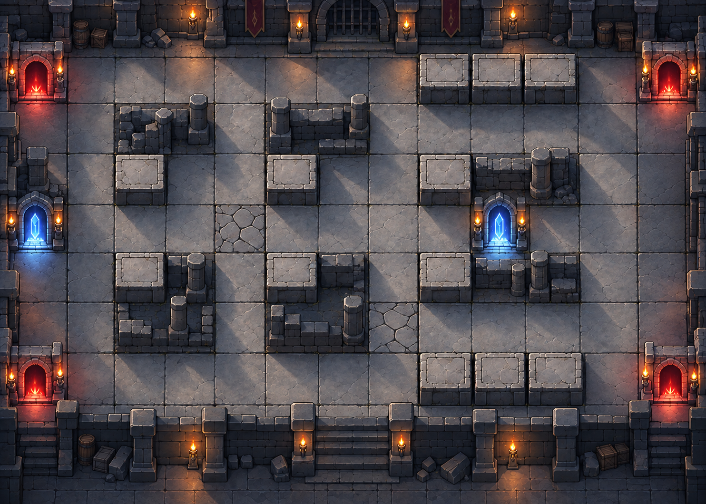

# 던전 원정대

게임공학과 **2023184009 김연준**의 2D 게임 프로그래밍 프로젝트입니다.

던전을 탐험하며 동료를 모집하고 강화해 최종 보스를 쓰러뜨리는 **타워 디펜스 형식의 로그라이크 게임**을 기획합니다. Python과 pico2d로 개발할 예정입니다.

## 제출 자료

- **발표 동영상:** [YouTube에서 보기](https://www.youtube.com/watch?v=OwTFQGSFT5A)
- **발표 PPT:** [6장 발표 자료 다운로드](docs/발표_PPT_던전원정대_김연준.pptx)
- **기획서 PPT:** [스프라이트를 포함한 24장 상세 기획서 다운로드](docs/기획서_PPT_던전원정대_김연준.pptx)
- [텍스트 기획서](docs/기획서.md)
- [발표 대본](docs/발표대본.txt)

## 게임 소개

처음에는 동료 3명으로 탐험을 시작합니다. 근접·원거리·힐러·특수 직업군을 조합해 최대 6명으로 파티를 편성하고, 배치 비용을 사용해 던전의 칸에 배치합니다. 기본 공격과 회복은 자동으로, 스킬은 플레이어가 직접 사용합니다.

일반 스테이지를 클리어하면 **동료 모집 / 기존 동료 강화 / 유물 획득 중 하나**를 선택합니다. 강화를 통해 새로운 스킬을 해금하고, 파티와 유물의 조합을 발전시켜 던전 최심부의 보스에 도전합니다.

## 목표 범위

| 항목 | 초기 개발 목표 |
| --- | --- |
| 동료 | 4개 직업군, 8명 / 전투 편성 최대 6명 |
| 스킬 | 동료당 2개, 총 16종 / 강화로 두 번째 스킬 해금 |
| 성장 | 동료 모집, 동료·스킬 강화, 유물 6종 |
| 전투 | 일반 스테이지 4개와 최종 보스전 1개 |
| 몬스터와 맵 | 일반 몬스터 2종, 보스 1종, 전투 맵 3종 |

현재는 **1차 발표 및 기획 단계**입니다. 캐릭터·카드·UI·던전 배경은 제작한 이미지 시안이며 실제 플레이 화면이나 게임 기능의 구현 완료를 뜻하지 않습니다. 게임 실행 코드는 이후 개발하면서 추가합니다.

## 제작한 이미지




- 캐릭터 8명: 정면·뒷면·오른쪽 옆면의 대기와 공격 동작
- 스프라이트 시트 8개, 개별 투명 프레임 96장
- 배치 프로필 카드 8종, 스킬 프로필 카드 8종과 스킬 아이콘 16종
- 상하좌우 배치 방향 선택 UI, 높낮이와 목표 지점 2개를 가진 던전 배경
- [파일 규격과 제작 자료 안내](assets/README.md)

## 폴더

```text
docs/                      발표 PPT, 상세 기획서 PPT, 대본
assets/characters/sprites/ 스프라이트 시트와 개별 프레임
assets/characters/deployment/ 배치 프로필 카드
assets/characters/skills/  스킬 카드, 아이콘, 효과 기획 데이터
assets/maps/               던전 배경 시안
assets/ui/                 배치 방향 선택 UI
```

공격력, 회복량, 배치 비용, 스킬 재사용 시간과 유물 수치는 전투 구현 후 조정합니다. 6주 개발 계획은 개발 순서를 설명하는 상대 일정이며 실제 수업 일정에 맞춰 조정합니다.
