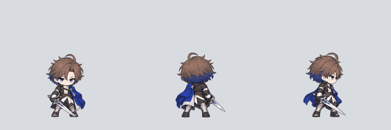

# 3방향 대기 애니메이션

8명의 동료가 제자리에서 숨을 쉬며 상체를 움직이고, 머리카락과 옷자락이 흔들리는 대기 모션입니다. 정면·뒷면·오른쪽 옆면을 제공합니다.



## 캐릭터별 재생 미리보기

GIF 한 장에 왼쪽부터 정면·뒷면·오른쪽 옆면이 함께 재생됩니다. GIF의 회색 바탕은 미리보기용이며 게임용 PNG는 투명합니다.

| 캐릭터 | GIF | 게임용 시트 | 프레임 정보 |
| --- | --- | --- | --- |
| 검사 | [재생](previews/swordsman.gif) | [PNG](atlases/swordsman.png) | [JSON](metadata/swordsman.json) |
| 수호기사 | [재생](previews/guardian.gif) | [PNG](atlases/guardian.png) | [JSON](metadata/guardian.json) |
| 궁수 | [재생](previews/archer.gif) | [PNG](atlases/archer.png) | [JSON](metadata/archer.json) |
| 석궁병 | [재생](previews/crossbowman.gif) | [PNG](atlases/crossbowman.png) | [JSON](metadata/crossbowman.json) |
| 성직자 | [재생](previews/cleric.gif) | [PNG](atlases/cleric.png) | [JSON](metadata/cleric.json) |
| 약초사 | [재생](previews/herbalist.gif) | [PNG](atlases/herbalist.png) | [JSON](metadata/herbalist.json) |
| 냉기술사 | [재생](previews/frost-mage.gif) | [PNG](atlases/frost-mage.png) | [JSON](metadata/frost-mage.json) |
| 그림자 도적 | [재생](previews/shadow-thief.gif) | [PNG](atlases/shadow-thief.png) | [JSON](metadata/shadow-thief.json) |

## 규격과 재생

- 8명 × 3방향 × 고유 자세 4장 = 투명 PNG 96장, 방향별 애니메이션 24개
- 개별 프레임: 320 × 320, RGBA
- 시트: 캐릭터당 1280 × 960, 가로 4칸 × 세로 3칸
- 행: 위에서부터 `front`, `back`, `right`
- 열: 왼쪽부터 `idle_00`, `idle_01`, `idle_02`, `idle_03`
- 발 기준점: 왼쪽 위 원점 기준 `(160, 288)`, 왼쪽 아래 원점에서는 `(160, 32)`
- 재생 열 순서: `0 → 1 → 2 → 3 → 2 → 1 → 반복`
- 각 단계 시간: `320, 320, 320, 400, 320, 320`밀리초, 한 주기 2초
- 전체 크기를 유지하고 발 위치를 맞춰 상체·머리·복장의 움직임이 보이도록 구성했습니다.

`frames/`에 개별 PNG, `atlases/`에 게임용 시트, `metadata/`에 캐릭터별 좌표와 타이밍, `manifest.json`에 전체 목록을 제공합니다. `rect`와 `pivot`은 왼쪽 위 원점이며, `pico2d_rect`는 pico2d의 왼쪽 아래 원점입니다. `preview-atlases/`의 축소 WebP는 미리보기용입니다.

## pico2d 적용 예시

다음은 프로젝트 루트에서 시트를 불러온 뒤, 누적 시간으로 대기 프레임을 고르는 예시입니다. 게임 루프에서는 `elapsed += frame_time`으로 시간을 누적하고 `draw_idle(image, elapsed, 'front', x, y)`를 호출합니다. `(x, y)`는 캐릭터의 발 위치입니다.

```python
from pico2d import load_image

image = load_image('assets/characters/idle-v1/atlases/swordsman.png')
PATTERN = (0, 1, 2, 3, 2, 1)
DURATIONS_MS = (320, 320, 320, 400, 320, 320)
ROWS = {'front': 0, 'back': 1, 'right': 2}


def idle_column(elapsed_seconds):
    remaining = (elapsed_seconds * 1000) % 2000
    for column, duration in zip(PATTERN, DURATIONS_MS):
        if remaining < duration:
            return column
        remaining -= duration
    return 0


def draw_idle(image, elapsed_seconds, direction, x, y, scale=1.0):
    column = idle_column(elapsed_seconds)
    row = ROWS[direction]
    image.clip_draw(
        column * 320, (2 - row) * 320, 320, 320,
        x, y + 128 * scale, 320 * scale, 320 * scale
    )
```

## 제작 및 확인

내장 `image_gen`으로 기존 캐릭터를 참조해 네 단계의 대기 자세를 생성했습니다. [제작 지시문 전체](generation-prompts.json)를 함께 보관합니다. 이후 같은 캐릭터에 일정한 배율을 적용하고, 거의 투명한 가장자리 잔여색을 정리한 뒤, 발 위치를 평행 이동으로 정렬해 프레임과 시트로 분리했습니다.

96개 프레임의 규격·투명도·고유 자세와 발 기준선, 24개 방향의 반복 재생을 확인했습니다. 기존 `../sprites/`의 정적 대기와 공격 96프레임은 보존했습니다. 현재 자료는 게임에 사용할 이미지이며 게임 실행 코드에 연결하는 작업은 별도로 필요합니다.
