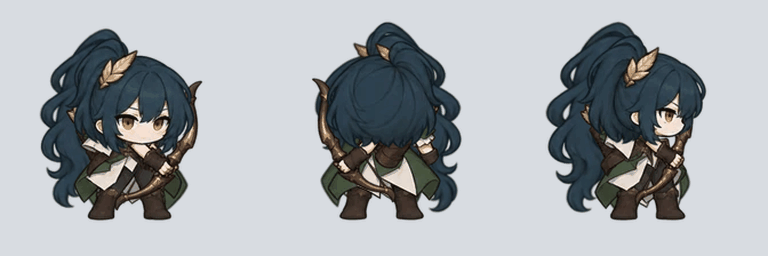

# 부드러운 3방향 대기 모션 v2

몸·머리·뒤쪽 머리카락과 옷자락을 분리해 연속적으로 움직이는 대기 모션입니다. 다리와 발은 고정하고, 상체의 호흡에 머리와 옷자락이 조금 늦게 따라오도록 구성했습니다. 한 주기는 2초입니다.



## 파일

- `layers/`: 내장 이미지 생성으로 그린 캐릭터별 투명 분리 그림, 1280 × 960
- `rigs.json`, `metadata/*-rig.json`: 각 부분의 위치·연결점·그리는 순서
- `rig-player.js`: 브라우저에서 화면 갱신마다 연결점의 위치와 각도를 계산하는 재생 코드
- `atlases/{캐릭터}/{front,back,right}.png`: pico2d에서 사용할 수 있게 방향별 48프레임으로 내보낸 투명 PNG 시트
- `metadata/{캐릭터}.json`: 시트의 칸 좌표, 발 기준점, 재생 시간
- `previews/`: 세 방향을 함께 재생하는 GIF
- `preview-layers/`: 화면 미리보기용으로 압축한 분리 그림
- [generation-prompts.json](generation-prompts.json): 사용한 제작 지시문과 참조 자료

## 캐릭터별 미리보기

| 캐릭터 | GIF | 게임용 시트 폴더 | 좌표·재생 정보 |
| --- | --- | --- | --- |
| 검사 | [재생](previews/swordsman.gif) | [PNG](atlases/swordsman/) | [JSON](metadata/swordsman.json) |
| 수호기사 | [재생](previews/guardian.gif) | [PNG](atlases/guardian/) | [JSON](metadata/guardian.json) |
| 궁수 | [재생](previews/archer.gif) | [PNG](atlases/archer/) | [JSON](metadata/archer.json) |
| 석궁병 | [재생](previews/crossbowman.gif) | [PNG](atlases/crossbowman/) | [JSON](metadata/crossbowman.json) |
| 성직자 | [재생](previews/cleric.gif) | [PNG](atlases/cleric/) | [JSON](metadata/cleric.json) |
| 약초사 | [재생](previews/herbalist.gif) | [PNG](atlases/herbalist/) | [JSON](metadata/herbalist.json) |
| 냉기술사 | [재생](previews/frost-mage.gif) | [PNG](atlases/frost-mage/) | [JSON](metadata/frost-mage.json) |
| 그림자 도적 | [재생](previews/shadow-thief.gif) | [PNG](atlases/shadow-thief/) | [JSON](metadata/shadow-thief.json) |

GIF의 바탕은 미리보기용입니다. 게임용 PNG는 투명합니다.

## 시트 규격

- 캐릭터 8명 × 3방향 = 애니메이션 24개, 시트 24개
- 방향마다 48프레임, 전체 1,152프레임
- 개별 칸 320 × 320, 시트 2560 × 1920, 가로 8칸 × 세로 6칸
- 위쪽 행부터 왼쪽에서 오른쪽으로 0~47 순서
- 초당 24프레임, 주기 2초, 첫 프레임을 끝에 중복해 넣지 않음
- 발 기준점: 왼쪽 위 원점에서 `(160, 288)`, 왼쪽 아래 원점에서 `(160, 32)`
- `rect`는 왼쪽 위 원점, `pico2d_rect`는 왼쪽 아래 원점

실시간 분리 그림 재생은 화면 갱신 속도에 맞춰 움직임을 계산합니다. PNG 시트는 같은 움직임을 24fps로 저장한 것입니다. GIF는 형식의 시간 단위에 맞춰 40/50ms 간격을 조합하고 전체 2초를 유지합니다.

## pico2d 적용 예시

프로젝트 루트에서 실행하며, 게임 루프의 경과 시간 `elapsed`를 누적해서 사용합니다. `(x, y)`는 발 위치입니다.

```python
from pico2d import load_image

idle = load_image('assets/characters/idle-v2/atlases/archer/front.png')


def draw_idle(image, elapsed, x, y, scale=1.0):
    frame = int(elapsed * 24) % 48
    column = frame % 8
    row = frame // 8
    image.clip_draw(
        column * 320, (5 - row) * 320, 320, 320,
        x, y + 128 * scale, 320 * scale, 320 * scale
    )
```

## 제작과 확인

기존 캐릭터의 정면·뒷면·오른쪽 모습을 참조해 내장 `image_gen`으로 분리 그림을 제작했습니다. 그림을 같은 배율로 정리하고 발을 정렬한 뒤, 연결점 기준의 회전·이동·호흡 곡선을 코드로 적용했습니다. 원본 그림의 전체 크기와 얼굴 형태를 매 프레임 다시 생성하지 않으므로 재생 중 형태 변화가 줄어듭니다.

48개 샘플의 변화, 투명 배경, 발의 고정, 마지막에서 처음으로 이어지는 연결과 실제 반복 재생을 확인했습니다. 작은 화면의 표시, 일시정지와 재생도 확인했습니다. 기존 정적 대기·공격과 [v1 대기 시트](../idle-v1/README.md)는 보존합니다. 게임의 캐릭터 상태와 연결하는 코드는 이후 전투 구현에 맞춰 추가해야 합니다.
