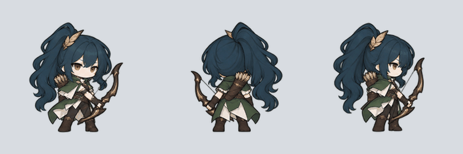

# 비율과 무기 가림을 보정한 대기 모션 v3

기존 캐릭터의 완성된 정적 대기 그림을 그대로 사용합니다. 머리·몸을 다시 조립하지 않고 한 장의 그림에 연속적인 호흡과 작은 흔들림을 적용해, 원본 비율과 손·무기·머리카락이 겹치는 관계를 유지합니다. 다리와 발은 고정합니다.

호흡에 따른 상체 이동, 좌우 흔들림, 머리 기울기와 머리카락·옷자락의 움직임을 더 잘 보이도록 조정했습니다. 한 주기는 기존과 같은 2초입니다.

[전체 캐릭터 미리보기](preview.html)는 내려받아 Chrome에서 열면 실행됩니다. 이미지와 코드가 한 파일에 포함되어 있습니다. 아래 MP4와 GIF로도 확인할 수 있습니다.



## 캐릭터별 재생

왼쪽부터 정면·뒷면·오른쪽 옆면입니다. 동영상은 2초 모션을 세 번 반복하는 6초 영상입니다.

| 캐릭터 | MP4 | GIF | 게임용 PNG 시트 | 좌표·시간 |
| --- | --- | --- | --- | --- |
| 검사 | [재생](previews/swordsman.mp4) | [재생](previews/swordsman.gif) | [PNG](atlases/swordsman/) | [JSON](metadata/swordsman.json) |
| 수호기사 | [재생](previews/guardian.mp4) | [재생](previews/guardian.gif) | [PNG](atlases/guardian/) | [JSON](metadata/guardian.json) |
| 궁수 | [재생](previews/archer.mp4) | [재생](previews/archer.gif) | [PNG](atlases/archer/) | [JSON](metadata/archer.json) |
| 석궁병 | [재생](previews/crossbowman.mp4) | [재생](previews/crossbowman.gif) | [PNG](atlases/crossbowman/) | [JSON](metadata/crossbowman.json) |
| 성직자 | [재생](previews/cleric.mp4) | [재생](previews/cleric.gif) | [PNG](atlases/cleric/) | [JSON](metadata/cleric.json) |
| 약초사 | [재생](previews/herbalist.mp4) | [재생](previews/herbalist.gif) | [PNG](atlases/herbalist/) | [JSON](metadata/herbalist.json) |
| 냉기술사 | [재생](previews/frost-mage.mp4) | [재생](previews/frost-mage.gif) | [PNG](atlases/frost-mage/) | [JSON](metadata/frost-mage.json) |
| 그림자 도적 | [재생](previews/shadow-thief.mp4) | [재생](previews/shadow-thief.gif) | [PNG](atlases/shadow-thief/) | [JSON](metadata/shadow-thief.json) |

## 규격

- 8명 × 3방향 = 애니메이션 24개, 시트 24개
- 방향마다 48프레임, 전체 1,152프레임
- 24fps, 한 주기 2초, 반복 시 끝에 첫 프레임을 중복하지 않음
- 개별 칸 320 × 320, 시트 2560 × 1920, 가로 8칸 × 세로 6칸
- 발 기준점: 왼쪽 위 원점 `(160, 288)`, 왼쪽 아래 원점 `(160, 32)`
- 시트의 위쪽 행부터 왼쪽에서 오른쪽으로 0~47 순서
- `rect`는 왼쪽 위 원점, `pico2d_rect`는 왼쪽 아래 원점

`sources/`에는 정면·뒷면·옆면을 가로로 모은 원본 그림, `source-webp/`에는 같은 그림의 무손실 WebP, `motion-player.js`에는 실시간 재생 코드, `motions.json`에는 움직임과 원본 파일의 해시가 들어 있습니다. 게임용 PNG는 무손실 RGBA이며, GIF와 MP4의 회색 배경은 미리보기용입니다.

## pico2d 적용 예시

프로젝트 루트에서 실행하며 `elapsed`에는 게임 루프에서 누적한 초 단위 시간을 전달합니다. `(x, y)`는 발 위치입니다.

```python
from pico2d import load_image

idle = load_image('assets/characters/idle-v3/atlases/archer/front.png')


def draw_idle(image, elapsed, x, y, scale=1.0):
    frame = int(elapsed * 24) % 48
    column, row = frame % 8, frame // 8
    image.clip_draw(
        column * 320, (5 - row) * 320, 320, 320,
        x, y + 128 * scale, 320 * scale, 320 * scale
    )
```

## 확인한 내용

24개 방향의 기본 자세를 기존 정적 대기 PNG와 비교했습니다. 불투명한 부분의 색은 일치하고, 비율과 원본의 무기 가림 관계를 유지합니다. 호흡과 작은 머리카락·옷자락의 흔들림을 연속적으로 적용하고, 고정된 발 픽셀과 반복 경계의 일치도 확인했습니다. 브라우저의 실제 재생, 일시정지, 작은 화면에서 정사각형 비율이 유지되는지도 확인했습니다.

게임의 캐릭터 상태에 모션을 연결하는 작업은 전투 구현에 맞춰 진행해야 합니다. 이전 [v1](../idle-v1/README.md)과 [v2](../idle-v2/README.md) 자료는 보관합니다.
