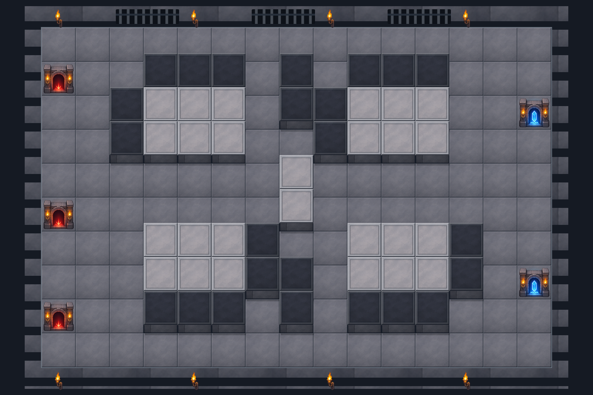

# 1층·2층·도착 지점을 격자에 맞춘 맵

지하 감옥·침수 유적·용암 제단을 고정된 칸 데이터로 다시 조립했습니다. 바닥과 2층 단상의 윗면은 같은 88 × 88 크기입니다. 2층은 같은 논리 격자에서 높이만 22픽셀 올려 표현합니다. 파란 도착 문 두 개는 각각 1층의 한 칸 안에 들어갑니다.

| 맵 | 완성 배경 | 칸 확인 그림 | 실행용 칸 좌표 |
| --- | --- | --- | --- |
| 지하 감옥 | [PNG](prison-cellblock.png) | [1·2층과 도착 칸](grid-checks/prison-cellblock.png) | [JSON](metadata/prison-cellblock.json) |
| 침수 유적 | [PNG](flooded-ruins.png) | [1·2층과 도착 칸](grid-checks/flooded-ruins.png) | [JSON](metadata/flooded-ruins.json) |
| 용암 제단 | [PNG](magma-altar.png) | [1·2층과 도착 칸](grid-checks/magma-altar.png) | [JSON](metadata/magma-altar.json) |



## 공통 격자

- 캔버스: 1536 × 1024
- 칸 배열: 가로 15 × 세로 10, 맵마다 150칸
- 기준점: 캔버스 왼쪽 위에서 `(108, 72)`
- 모든 칸의 윗면: 88 × 88
- 1층 높이: 0픽셀, 2층 높이: 22픽셀
- 빨간 입구 3개와 파란 도착 문 2개: 각각 1층 한 칸
- 2층 캐릭터 배치 공간: 감옥 26칸, 침수 유적 36칸, 용암 제단 31칸

칸의 기본 위치는 `x = 108 + 열 × 88`, `y = 72 + 행 × 88`입니다. 2층의 윗면을 그릴 때만 `y`에서 22를 뺍니다. 따라서 두 층의 칸 크기와 좌우 경계는 같고, 시점에 따른 높이 차이만 생깁니다.

## 좌표 데이터

[layouts.json](layouts.json)은 실제 배열을 저장합니다. `.`은 1층 배치 가능 바닥, `H`는 2층 배치 단상, `#`는 막힌 석조 구조물, `~`는 물·용암, `R`은 입구, `B`는 도착 지점입니다.

각 맵 JSON의 `cells`에는 다음 정보가 들어 있습니다.

- `column`, `row`: 칸 번호, 왼쪽 위가 0행·0열
- `floor`: 1층, 2층 또는 배치할 수 없는 지형의 `null`
- `base_rect`: 논리 격자의 바닥 영역
- `surface_rect`: 실제 보이는 윗면 영역, 2층은 22픽셀 위로 이동
- `canvas_center`: 왼쪽 위 원점 기준 윗면의 중심
- `pico2d_center`, `pico2d_surface_rect`: 왼쪽 아래 원점으로 변환한 좌표
- `walkable`, `deployable`, `placement`: 적 이동과 캐릭터 배치 가능 여부
- `portal_rect`: 입구·도착 문을 그리는 한 칸 영역

입구와 도착 지점은 이동할 수 있지만 캐릭터를 배치하지 않습니다. 2층과 막힌 지형에는 적이 올라가지 않습니다. `routes`에는 각 입구에서 각 도착 지점으로 가는 연결 경로가 있습니다. 게임에서는 이 데이터를 전투 흐름과 웨이브에 맞게 연결해야 합니다.

## 범위 표시

[range-overlay.png](range-overlay.png)는 이 맵의 한 칸에 맞는 88 × 88 반투명 타일입니다. 선택한 칸의 `pico2d_center`에 그리면 1층과 2층의 윗면에 각각 맞습니다.

```python
import json
from pico2d import load_image

with open('assets/maps/dungeon-grid-v2/metadata/prison-cellblock.json', encoding='utf-8') as f:
    map_data = json.load(f)

overlay = load_image('assets/maps/dungeon-grid-v2/range-overlay.png')
cell = next(c for c in map_data['cells'] if c['column'] == 3 and c['row'] == 2)
overlay.draw(*cell['pico2d_center'], 88, 88)
```

위 좌표는 원본 캔버스 크기 기준입니다. 화면에 맞춰 배경을 축소할 때 좌표와 타일 크기도 같은 배율로 바꿉니다. 서로 겹치는 칸의 클릭 판정은 `cells`를 뒤에서부터 검사하며 `surface_rect`를 사용합니다.

## 제작과 검증

내장 `image_gen`으로 석재·물·용암 소재와 문을 제작하고, 정수 좌표로 고정한 격자에 조립했습니다. [제작 지시문](generation-prompts.json), 원본 소재 `art/`, 타일 `tiles/`, 문 `objects/`, 편집 가능한 SVG를 함께 제공합니다. 기존 시안은 [dungeon-variants-v1](../dungeon-variants-v1/README.md)에 보존했습니다.

[validation.json](validation.json)에 칸 크기·높이·도착 지점의 한 칸 점유와 경로 검증을 기록했습니다. 450칸 모두 같은 크기이며, 각 맵의 입구 3개에서 목표 2개까지 여섯 연결을 모두 확인했습니다. 다른 이동 가능 바닥과 끊어진 바닥 구역도 없습니다. 격자 확인 그림에서 청록색은 1층, 주황색은 2층, 파란색은 도착 칸입니다.
