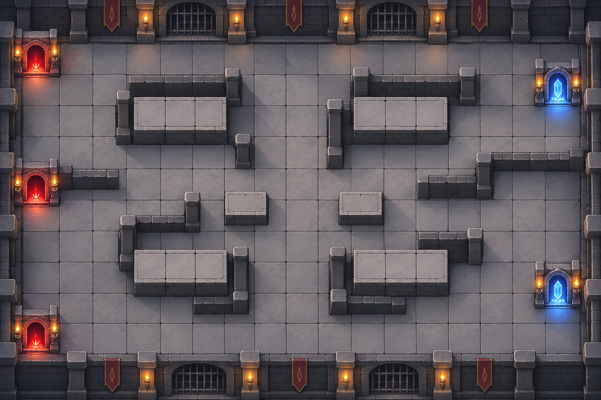
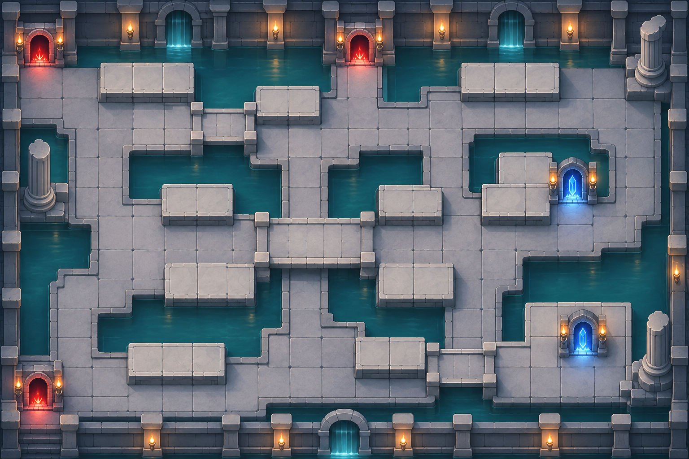
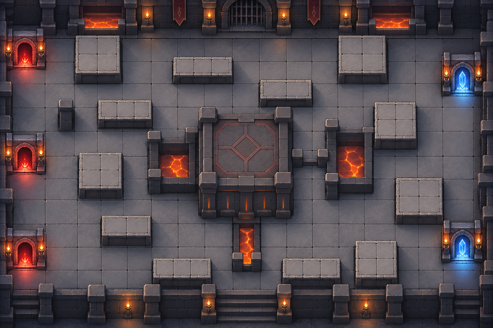

# 던전 맵 추가 3종

기존 기본 던전을 시점과 화풍의 기준으로 삼고, 서로 다른 지형과 길 배치를 가진 맵을 제작했습니다. 바닥과 단상 위는 캐릭터를 배치하기 쉽도록 넓게 비우고, 잔돌·균열·장식의 밀도는 낮췄습니다.

## 지하 감옥

철창과 회색 석재로 구성한 감옥입니다. 중앙 교차로와 네 개의 큰 단상 구역을 연결하는 넓은 통로가 특징입니다.

## 침수 유적

청록색 물웅덩이를 석조 길이 돌아가고, 다리들이 여러 섬을 잇습니다. 다리 주변의 단상을 활용하는 전투를 염두에 둔 배경입니다.

## 용암 제단

어두운 현무암과 제한된 용암 조명을 사용한 던전입니다. 중앙 제단 양옆으로 접근로를 나누고 주변에 배치용 단상을 배치했습니다.

## 규격과 제작

- 낮은 바닥과 한 단 높은 배치용 단상, 두 가지 높낮이
- 맵마다 파란 방어 목표 문 2개, 빨간 적 입구 문 3개
- 캐릭터·몬스터·화면 UI를 포함하지 않는 불투명 PNG 배경
- 각 파일의 해상도와 해시는 [manifest.json](manifest.json)에 기록
- 내장 `image_gen`으로 제작, [전체 제작 지시문](generation-prompts.json) 보관
- 화풍·시점 참고: [기본 던전](../dungeon-room.png)

이미지에 표현된 칸은 실행용 좌표로 보정하지 않은 상태입니다. 게임에 사용할 때 각 배경에 맞춰 이동 경로와 배치 가능 영역을 별도 데이터로 지정해야 합니다. 기존 배경과 다른 제작 자료는 보존했습니다.
