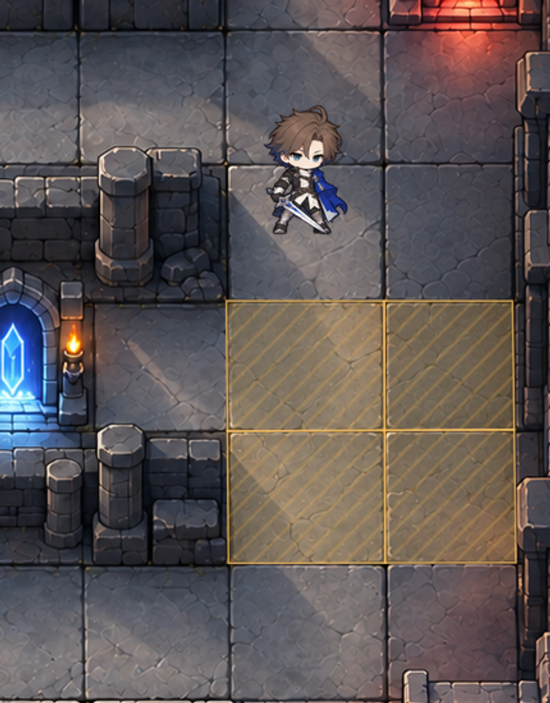

# 맵 칸에 맞춘 공격 범위 타일 v2

1484 × 1060 던전 이미지의 실제 바닥 경계를 측정해 크기와 위치를 맞췄습니다. 오른쪽 미리보기 영역은 칸 너비가 약 124px와 102px로 다르고 경계도 조금 기울어져 있습니다.



## 기본 타일

| 파일 | 기본 크기 |
| --- | --- |
| `png/attack-range-wide.png` | 넓은 칸용 124 × 102 |
| `png/attack-range-square.png` | 좁은 칸용 102 × 102 |
| `png/*-plain.png` | 같은 규격의 단색 버전 |
| `png-2x/` | 같은 타일의 가로·세로 2배 이미지 |
| `svg/` | 크기와 색을 수정할 수 있는 원본 |

바깥쪽 여백을 줄이고 테두리를 칸 가장자리에 맞췄습니다. 투명도는 PNG에 적용되어 있습니다.

## 미리보기의 4칸에 정확하게 배치하기

`map-cells/`의 PNG 4장은 해당 바닥 경계의 기울기까지 맞춘 이미지입니다. `map-alignment.json`에 각 이미지의 위치·크기와 모서리 좌표가 들어 있습니다. 이미지 바깥의 작은 투명 여백은 테두리를 잘리지 않게 담기 위한 여백입니다.

- `rect_top_left`: 원본 맵 왼쪽 위 기준 이미지 위치와 크기 `[x, y, width, height]`
- `center_pico2d`: 원본 맵을 원래 크기로 그렸을 때의 이미지 중심 좌표
- `quad_top_left`: 실제 바닥 경계의 모서리 4개
- 좌표 보정 범위는 미리보기에 표시한 오른쪽 바닥 4칸입니다. 이동 가능 여부와 전체 맵의 전투 격자는 별도 데이터입니다.

맵을 축소해서 그릴 때는 타일의 위치와 크기를 같은 비율로 조정합니다.

```python
# cell: map-alignment.json의 cells 항목 하나
# tile_image: cell['file']에 해당하는 pico2d 이미지
# map_left, map_bottom: 화면에서 맵의 왼쪽 아래 좌표
# map_width, map_height: 화면에 표시할 맵의 크기
x, y, width, height = cell['rect_top_left']
scale_x = map_width / 1484
scale_y = map_height / 1060
tile_image.draw(
    map_left + (x + width / 2) * scale_x,
    map_bottom + (1060 - y - height / 2) * scale_y,
    width * scale_x,
    height * scale_y,
)
```

맵 다음, 캐릭터 이전에 범위 타일을 그립니다. 미리보기의 범위 모양은 표시 예시이며 캐릭터의 실제 공격 능력치는 아닙니다.
