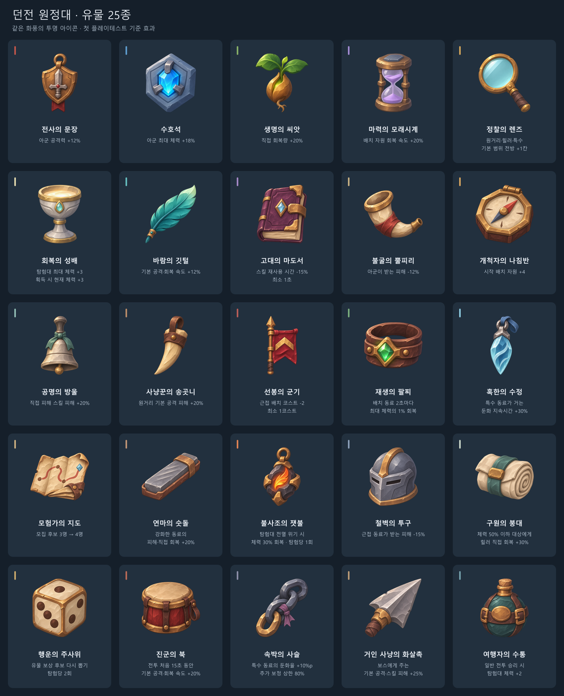

# 던전 원정대 상세 기획서
게임공학과 2023184009 김연준
타워 디펜스 형식의 로그라이크 / Python + pico2d

[발표 영상](https://www.youtube.com/watch?v=OwTFQGSFT5A) · [프로젝트 저장소](https://github.com/hyde3041/2DGameProgramming)

## 1. 던전 원정대 상세 게임 기획서

Python과 pico2d로 개발할 1인용 PC 게임의 1차 기획서다. 동료 모집, 강화로 새 스킬 해금, 유물 선택을 통해 파티를 성장시키고 보스전에 도전한다. 본 문서의 화면과 이미지는 제작한 시안이며 게임 구현 완료를 뜻하지 않는다.

던전 원정대

동료를 모집하고 성장시켜 / 던전의 최종 보스에 도전하는 / 타워 디펜스 형식의 로그라이크 게임

게임공학과 2023184009 김연준

## 2. 게임 소개와 최종 목표

플레이어는 고대 던전에 진입해 동료를 영입하고 전투를 진행한다. 근접·원거리·힐러·특수의 역할을 조합하고, 보상으로 파티의 약점을 보완하며 최심부의 보스에 도전한다.

동료를 모집하고 성장시켜 / 던전의 최종 보스에 도전

장르 / 타워 디펜스 + 로그라이크 /  / 플랫폼과 개발 도구 / PC / Python / pico2d /  / 파티 구성 / 시작 3명, 전투 편성 최대 6명

## 3. 한 번의 던전 탐험

매 전투 후 세 보상 유형 중 하나를 선택한다. 모집은 전술의 선택지를, 강화는 기존 동료의 전투력을, 유물은 파티 전체의 효과를 발전시킨다. 탐험마다 달라지는 선택으로 보스전에 대비하는 것이 핵심 재미다.

| 단계 | 진행 내용 |
| --- | --- |
| 1. 출발 | 동료 3명 모집과 초기 파티 구성 |
| 2. 전투 준비 | 출전 동료 최대 6명 편성, 배치 위치와 방향 선택 |
| 3. 배치 전투 | 자동 공격·회복과 수동 스킬로 몬스터 상대 |
| 4. 보상 선택 | 모집 / 기존 동료 강화 / 유물 중 한 가지 선택 |
| 5. 다음 구역 | 성장 결과를 유지하며 일반 스테이지 4개 진행 |
| 6. 최종 보스 | 강화된 파티로 보스를 처치하면 탐험 성공 |

## 4. 전투 화면과 승리 조건

근접 동료가 길목을 저지하고 원거리 공격과 힐러, 특수 동료가 지원한다. 목표 지점 두 개로 접근하는 몬스터를 상대한다. 일반 스테이지의 몬스터 처리는 격파 또는 방어선 통과에 따른 처리 완료를 뜻하며, 보스전에서는 보스를 실제로 처치해야 승리한다.

일반 스테이지

모든 몬스터를 처리하고 / 탐험대 체력이 남으면 승리

방어선과 패배

적이 목표 지점을 통과하면 / 탐험대 체력 감소 / 체력이 0이 되면 탐험 실패

최종 보스

보스 처치 시 탐험 성공 / 보스가 방어선을 넘으면 패배

이미지와 캐릭터를 배치한 전투 화면 구상

## 5. 던전 맵과 지형 규칙

낮은 지형과 높은 지형을 구분하고 각 캐릭터의 배치 가능 지형을 데이터로 관리한다. 특수 직업군은 냉기술사는 높은 지형, 그림자 도적은 낮은 지형을 사용하는 초안이다. 목표 지점과 길목을 기준으로 배치 전략을 설계한다.

낮은 지형 / 근접 동료 배치와 적의 이동 /  / 높은 지형 / 원거리와 힐러 중심의 배치 /  / 목표 지점 2개 / 여러 길목에 파티를 분산 배치

목표 맵 3종 / 폐허 회랑 / 유적 전당 / 심층 제단

현재 배경 시안 1종. 실제 칸 좌표·이동 경로·배치 가능 영역은 별도 데이터로 구성한다.

## 6. 배치 비용과 공격 방향

동료를 선택한 다음 칸과 방향을 정하는 조작을 사용한다. 방향 선택 UI는 중립·상·하·좌·우 총 5개 상태를 준비했다. 방향에 따라 캐릭터의 시선과 공격 범위가 달라진다.

1. 동료 카드 선택 / 2. 비용을 사용해 가능한 칸에 배치 / 3. 상하좌우 공격 방향 지정

배치 비용은 시간에 따라 회복 / 동료마다 배치 비용 설정 / 선택한 칸에서 공격·회복 범위 표시

위

오른쪽

아래

왼쪽

배치 비용과 회복 속도, 캐릭터별 공격 범위는 실제 전투 테스트로 조정한다.

## 7. 동료 모집과 최대 6명 편성

시작 모집은 후보 중 하나를 고르는 과정을 3회 진행하는 초안이다. 탐험 중에는 모집 보상을 선택했을 때 새 동료를 얻는다. 매 스테이지에서 동료를 보장하지 않으며, 같은 캐릭터를 중복 영입하거나 중복 편성하지 않는다.

후보 3명 중 1명 영입

제작한 배치 프로필 카드의 모집 후보 예시

시작 모집

초기 동료 3명을 선택해 출발

탐험 중 모집

모집 보상을 고르면 새 동료 영입 / 이미 보유한 동료는 후보에서 제외

전투 파티

보유 동료 중 최대 6명 출전 / 6명을 넘으면 전투 전에 편성 조정

모집 보상을 선택한 횟수에 따라 보스전까지 확보하는 동료 수가 달라진다.

## 8. 4개 직업군과 동료 8명

근접은 전선을 유지하고, 원거리는 뒤에서 적을 처리한다. 힐러는 파티의 생존을 보조하며 특수는 적을 묶거나 이동을 방해한다. 특정 직업만 모으기보다 모집 결과에 맞춰 역할을 보완하는 편성 판단을 유도한다.

| 직업군 | 동료 | 전투 역할 |
| --- | --- | --- |
| 근접 | 검사 / 수호기사 | 낮은 지형에서 저지와 근접 공격 |
| 원거리 | 궁수 / 석궁병 | 높은 지형에서 집중·다중·관통 공격 |
| 힐러 | 성직자 / 약초사 | 체력이 낮은 동료 회복과 생존 지원 |
| 특수 | 냉기술사 / 그림자 도적 | 둔화·기절과 단일 대상 제압 |

## 9. 스테이지 보상과 선택의 재미

현재 보상 구조는 최신 발표 대본에 맞춘 선택형이다. 모집으로 인원을 늘릴지, 기존 전력을 강화할지, 유물 효과를 얻을지 판단한다. 동료와 유물의 무작위 후보가 매 탐험의 편성과 전략을 바꾸며, 탐험 전체의 성장 결과를 보스전에서 시험한다.

| 보상 선택 | 얻는 효과 | 선택할 상황 |
| --- | --- | --- |
| 새 동료 모집 | 새 역할과 전술의 선택지 확보 | 파티에 필요한 역할이 부족할 때 |
| 기존 동료 강화 | 능력치 상승과 새로운 스킬 해금 | 이미 확보한 핵심 동료를 키울 때 |
| 유물 획득 | 이번 탐험 동안 유지되는 추가 효과 | 파티의 강점을 확장할 때 |

## 10. 동료 강화와 새로운 스킬 해금

강화 보상에서는 보유 동료 한 명을 고른다. 능력치를 높이고 처음 강화하는 동료는 두 번째 스킬을 해금한다. 추가 강화는 기존 공격·회복·상태 효과의 수치를 높이는 구조로 시작한다. 모든 동료는 서로 다른 2개 스킬을 목표로 한다.

기본 보유: S1 청광 베기

전방의 적 하나에게 강한 근접 피해

첫 강화: S2 검무 해금

공격력과 공격 속도를 높이는 새 선택지

이후 강화: 능력치와 스킬 효과 향상

기본 S1 보유, 첫 강화로 S2 해금은 기획 초안. 강화 단계와 조건, 상승량은 추후 조정한다.

## 11. 유물 25종의 효과와 파티 시너지

유물은 현재 탐험 동안 유지되며 같은 유물을 중복 획득하지 않는다. 유물 보상은 조건을 만족하는 미보유 후보 최대 3개 중 하나를 고른다. 기존 18종을 보존하고 새 7종을 추가해 전체 25종의 수치·대상·발동 조건을 정리했다. 수치는 첫 플레이테스트 기준이며, 초기 구현은 원래 목표인 첫 6종부터 시작하고 나머지 19종으로 확장한다.

| 유물 | 효과 | 역할 |
| --- | --- | --- |
| 전사의 문장 | 아군 공격력 +12% | 공격 |
| 수호석 | 아군 최대 체력 +18% | 체력 |
| 생명의 씨앗 | 아군 직접 회복량 +20% | 회복 |
| 마력의 모래시계 | 배치 자원 자연 회복 속도 +20% | 배치 |
| 정찰의 렌즈 | 원거리·힐러·특수의 기본 공격·회복 범위를 전방 1칸 연장 | 범위 |
| 회복의 성배 | 탐험대 최대 체력 +3, 획득 시 현재 체력도 +3 | 탐험대 |
| 바람의 깃털 | 아군 기본 공격·회복 속도 +12% | 행동 속도 |
| 고대의 마도서 | 스킬 재사용 시간 -15% (최소 1초) | 스킬 |
| 불굴의 뿔피리 | 배치 동료가 받는 피해 -12% | 방어 |
| 개척자의 나침반 | 매 전투 시작 배치 자원 +4 | 배치 |
| 공명의 방울 | 직접 피해를 주는 스킬의 피해 +20% | 스킬 피해 |
| 사냥꾼의 송곳니 | 원거리 동료의 기본 공격 피해 +20% | 원거리 |
| 선봉의 군기 | 근접 동료 배치 코스트 -2 (최소 1) | 배치 |
| 재생의 팔찌 | 배치 동료가 2초마다 최대 체력의 1% 회복 | 지속 회복 |
| 혹한의 수정 | 특수 동료가 거는 둔화 지속시간 +30% | 둔화 |
| 모험가의 지도 | 탐험 중 모집 후보를 3명에서 4명으로 증가 | 모집 |
| 연마의 숫돌 | 획득 후 강화한 동료의 피해·직접 회복량 +20% (동료당 1회) | 강화 |
| 불사조의 잿불 | 탐험대 체력이 0이 될 때 최대 체력의 30%로 회복 (탐험당 1회) | 위기 대응 |
| 철벽의 투구 | 근접 동료가 받는 피해 -15% | 근접 생존 |
| 구원의 붕대 | 체력 50% 이하인 대상에게 힐러의 직접 회복량 +30% | 긴급 회복 |
| 행운의 주사위 | 유물 보상 후보 다시 뽑기 2회 (탐험당) | 보상 선택 |
| 진군의 북 | 매 전투 처음 15초 동안 아군 기본 공격·회복 속도 +20% | 초반 전투 |
| 속박의 사슬 | 특수 동료의 둔화율 +10%p (보정 상한 80%) | 둔화 강화 |
| 거인 사냥의 화살촉 | 보스에게 주는 기본 공격·직접 피해 스킬 피해 +25% | 보스 대응 |
| 여행자의 수통 | 일반 전투 승리 시 탐험대 체력 +2 | 탐험 유지 |

같은 능력치·최종 피해·직접 회복 보너스는 합산하고 공격력·최종 피해·기본 행동 속도는 서로 다른 단계에서 계산한다. 받는 피해 감소 배율은 서로 곱한다. 직접 회복·최대 체력 비례 재생·탐험대 회복을 구분한다. 불사조의 잿불은 탐험당 1회, 행운의 주사위는 성공한 후보 갱신을 탐험당 2회, 연마의 숫돌은 획득 후 각 동료의 첫 강화에 1회 적용한다.

[세부 효과·발동 조건·계산 예시](유물효과.md), [효과 데이터](../metadata/item/effects.json), [그림 및 파일 규격](../metadata/README.md)을 함께 정리했다.

## 12. 스테이지와 몬스터 구성

탐험대는 폐허 회랑과 유적 전당을 거쳐 심층 제단으로 향한다. 고블린은 빠르게 방어선에 접근하고 중갑 스켈레톤은 체력이 높고 느린 역할을 맡는 초안이다. 전투 사이에는 동료 체력과 스킬 대기시간을 초기화하고, 탐험대 체력과 성장 결과는 유지한다.

| 구간 | 맵 | 출현 구성 초안 |
| --- | --- | --- |
| 일반 1 | 폐허 회랑 | 고블린 정찰병 중심, 기본 배치 익히기 |
| 일반 2 | 유적 전당 | 중갑 스켈레톤 등장, 지속 공격 필요 |
| 일반 3 | 폐허 회랑 재사용 | 두 몬스터 혼합, 여러 길목 방어 |
| 일반 4 | 유적 전당 재사용 | 출현 수와 조합 강화, 보스전 준비 |
| 최종 보스 | 심층 제단 | 고대 수호자 처치 |

## 13. 캐릭터 스프라이트: 근접

근접 동료 2명의 제작한 스프라이트 시트다. 캐릭터마다 방향 3개와 자세 4개를 포함한다. 무기와 복장의 디자인을 유지하고 각 프레임의 발 기준점을 맞췄다. 대기 1장과 공격 3단계를 준비했으며 걷기·피격·사망 동작은 포함하지 않는다.

검사

수호기사

각 시트: 위부터 정면·뒷면·오른쪽 / 왼쪽부터 대기·준비·발동·마무리

## 14. 캐릭터 스프라이트: 원거리

원거리 동료 2명의 제작한 스프라이트 시트다. 캐릭터마다 방향 3개와 자세 4개를 포함한다. 무기와 복장의 디자인을 유지하고 각 프레임의 발 기준점을 맞췄다. 대기 1장과 공격 3단계를 준비했으며 걷기·피격·사망 동작은 포함하지 않는다.

궁수

석궁병

각 시트: 위부터 정면·뒷면·오른쪽 / 왼쪽부터 대기·준비·발동·마무리

## 15. 캐릭터 스프라이트: 힐러

힐러 동료 2명의 제작한 스프라이트 시트다. 캐릭터마다 방향 3개와 자세 4개를 포함한다. 무기와 복장의 디자인을 유지하고 각 프레임의 발 기준점을 맞췄다. 대기 1장과 공격 3단계를 준비했으며 걷기·피격·사망 동작은 포함하지 않는다.

성직자

약초사

각 시트: 위부터 정면·뒷면·오른쪽 / 왼쪽부터 대기·준비·발동·마무리

## 16. 캐릭터 스프라이트: 특수

특수 동료 2명의 제작한 스프라이트 시트다. 캐릭터마다 방향 3개와 자세 4개를 포함한다. 무기와 복장의 디자인을 유지하고 각 프레임의 발 기준점을 맞췄다. 대기 1장과 공격 3단계를 준비했으며 걷기·피격·사망 동작은 포함하지 않는다.

냉기술사

그림자 도적

각 시트: 위부터 정면·뒷면·오른쪽 / 왼쪽부터 대기·준비·발동·마무리

## 17. 스프라이트 구성과 애니메이션 규격

스프라이트 8개 시트에 총 96프레임이 들어 있다. 왼쪽 방향은 오른쪽 옆면을 수평 반전해 사용하는 초안이며 무기와 복장의 좌우도 함께 반전된다. 캐릭터마다 공격 준비·발동·마무리 시간을 다르게 설정해 동작 속도를 조절한다. 투사체와 회복 효과는 별도 게임 객체로 처리할 계획이다.

대기

준비

발동

마무리

프레임과 시트

320 × 320 투명 PNG / 시트는 1280 × 960

같은 발 기준점

왼쪽 위 원점 (160, 288) / 프레임마다 위치를 일정하게 유지

공격 재생

준비·발동·마무리 후 대기 / 검사 예시 160 / 90 / 180ms

메타데이터에 프레임 위치와 재생 시간 포함. pico2d 좌표는 왼쪽 아래 원점으로 제공한다.

## 18. 스킬 구성: 근접과 원거리

기본 스킬 S1을 먼저 사용하고 동료 강화로 S2를 해금한다. 준비된 스킬은 플레이어가 전투 상황에 맞춰 직접 사용한다. 효과 설명은 기획 초안이며 피해량, 회복량, 지속 시간과 재사용 시간은 구현 후 조정한다.

| 동료 | S1 기본 스킬 | S2 강화로 해금 |
| --- | --- | --- |
| 검사 | 청광 베기 전방의 적 하나에게 강한 근접 피해 | 검무 잠시 자신의 공격력과 공격 속도 증가 |
| 수호기사 | 수호의 맹세 잠시 자신이 받는 피해 감소 | 방패 강타 막고 있는 적에게 피해를 주고 잠시 기절 |
| 궁수 | 속사 잠시 자신의 기본 공격 속도 증가 | 갈래 화살 범위 안 여러 적을 동시에 공격 |
| 석궁병 | 관통 사격 일직선 위의 적들을 관통하는 사격 | 약점 포착 범위 안 적 하나에게 강한 원거리 피해 |

## 19. 스킬 구성: 힐러와 특수

기본 스킬 S1을 먼저 사용하고 동료 강화로 S2를 해금한다. 준비된 스킬은 플레이어가 전투 상황에 맞춰 직접 사용한다. 효과 설명은 기획 초안이며 피해량, 회복량, 지속 시간과 재사용 시간은 구현 후 조정한다.

| 동료 | S1 기본 스킬 | S2 강화로 해금 |
| --- | --- | --- |
| 성직자 | 치유의 빛 범위 안 아군 하나의 체력을 즉시 회복 | 생명의 성역 범위 안 여러 아군의 체력을 동시에 회복 |
| 약초사 | 응급 처치 체력이 낮은 아군을 빠르게 회복 | 재생 물약 잠시 아군의 체력을 지속해서 회복 |
| 냉기술사 | 서리 속박 범위 안 적들의 이동 속도 감소 | 빙결 감옥 범위 안 적들을 얼려서 잠시 기절 |
| 그림자 도적 | 급소 찌르기 적 하나의 급소를 노려 강한 근접 피해 | 마비 독침 독침을 맞힌 적을 잠시 기절 |

## 20. 배치 프로필과 스킬 카드 시안

제작한 캐릭터 초상과 스킬 아이콘을 게임 UI에 활용한다. 이미지는 카드 시안이며 해금 상태나 재사용 시간 표시는 이후 게임 코드에서 표현한다. 배치 프로필은 기본 128×176, 스킬 카드는 360×544이며 2배 크기 이미지도 함께 준비했다.

전투 중 빠르게 확인

캐릭터 초상과 직업 표시 / S1·S2 이름과 효과 안내 / 잠긴 스킬과 사용 가능 상태 구분

스킬 사용 계획

선택한 동료의 스킬을 확인하고 / 준비된 스킬을 직접 사용 / 사용 뒤 재사용 대기시간 적용

프로필 카드 8종과 스킬 아이콘 16종을 준비했다. 잠금·대기시간 표시 기능은 구현 예정이다.

## 21. 주요 객체와 구현 책임

게임 반복문에서 입력 처리, 객체 상태 계산, 화면 그리기를 분리한다. 공격·회복·강화·방해 효과의 공통 처리를 먼저 만들고 캐릭터별 수치와 효과 조합으로 콘텐츠를 확장한다. 이 표는 구현 계획이며 아직 게임 실행 코드가 완성된 상태는 아니다.

| 구성 | 처리할 내용 |
| --- | --- |
| GameWorld | 동료·몬스터·효과 객체의 갱신과 그리기 |
| GameState | 모집·편성·전투·보상·결과 화면 전환 |
| Map | 칸의 높이, 배치 가능 영역, 적의 경로와 목표 지점 |
| Character | 능력치·방향·공격·회복·스킬·애니메이션 |
| Monster | 경로 이동, 저지 상태, 체력과 방어선 통과 |
| Reward | 후보 생성, 모집·강화·유물 선택과 탐험 데이터 유지 |

## 22. 개발 목표와 현재 준비 상태

이미지와 프로필은 제작한 시안이다. 게임 기능의 구현 완료를 의미하지 않으며, 맵의 실제 칸 데이터와 경로도 별도로 구성해야 한다. 개발 초반에는 한 번의 전투와 보상 선택이 실제로 작동하는 흐름을 먼저 검증한다.

| 항목 | 초기 완성 목표 | 현재 상태 |
| --- | --- | --- |
| 캐릭터 | 8명, 시트 8개와 개별 프레임 96장 | 이미지 시안 준비 |
| 스킬 | 동료당 2개, 총 16종과 해금·강화 | 카드·아이콘 준비 |
| 배치 UI | 동료 선택, 칸·방향 선택, 비용 처리 | 방향 이미지 5상태 준비 |
| 맵 | 3종으로 일반 전투 4개와 보스전 구성 | 배경 시안 1종 준비 |
| 몬스터 | 일반 2종과 최종 보스 1종 | 제작·구현 예정 |
| 기본 전투 | 자동 공격·회복, 저지와 수동 스킬 | 구현 예정 |
| 탐험 진행 | 보상 선택, 파티 성장, 보스전과 결과 | 구현 예정 |

## 23. 6주 기준 개발 계획

매 단계는 기능 단위로 구현하고 실제 동작을 확인한다. 초기에는 한 맵으로 배치·전투·보상을 검증한 다음 나머지 동료와 맵으로 범위를 확장한다. 애니메이션의 준비·발동·마무리 시간을 실제로 재생해 속도를 조절한다.

| 기간 | 개발 내용 | 완료 기준 |
| --- | --- | --- |
| 1주 | 게임 반복문, 맵 칸과 경로, 화면 전환 | 몬스터가 경로를 따라 이동 |
| 2주 | 배치 비용, 기본 공격·회복, 저지와 승패 | 일반 전투 1개 클리어 |
| 3주 | 모집, 최대 6명 편성, 동료 강화와 스킬 해금 | 선택한 보상이 파티에 반영 |
| 4주 | 유물과 스킬 효과, 스테이지 진행 | 일반 전투 4개와 보상 연결 |
| 5주 | 동료 8명과 스킬 16종, 최종 보스와 결과 | 탐험 시작부터 보스전까지 진행 |
| 6주 | 오류 수정, 난이도와 애니메이션 속도 조절 | 한 번의 탐험을 실제 플레이로 검증 |

## 24. 프로젝트 자료와 제출 링크

제출용 Git 저장소에서 발표 자료와 상세 기획서, 이미지 파일을 함께 제공한다. YouTube 링크는 사용자가 제공한 발표 영상 주소다. 과제 안내에 따라 발표 PPT는 6장으로 유지하고, 분량 제한이 없는 상세 기획서는 제작 자료와 규칙을 자세히 정리한다.

발표 동영상

https://www.youtube.com/watch?v=OwTFQGSFT5A

Git 저장소

https://github.com/hyde3041/2DGameProgramming

발표 PPT / 상세 기획서 PPT / 기획 문서 / 제작한 스프라이트와 UI

게임공학과 2023184009 김연준
